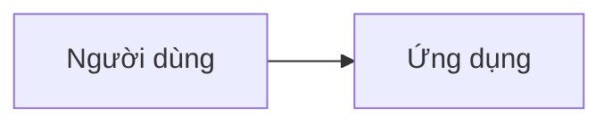

# Kiến trúc

## Bối cảnh


## Module
| Module | Trách nhiệm | Năng lực / mã | Thật hay giả lập |
|---|---|---|---|

## Dữ liệu
```mermaid
erDiagram
```

## Hợp đồng (API / sự kiện)
| Module | Endpoint / sự kiện | Vào | Ra | Lỗi |
|---|---|---|---|---|

## Quy tắc xuyên suốt
- Tiền, định danh, lỗi, xác thực, offline, idempotency.

## Stack
| Phần | Chọn | Lý do |
|---|---|---|

## ADR
- ADR-01 …
