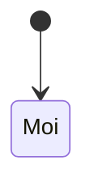

# <Tên năng lực> (<CAP>)

## Tóm tắt
Tối đa 5 dòng: năng lực này làm gì, cho ai, ranh giới với năng lực khác. Nguồn chính: `product/source/...`, `knowledge/...`.

## Vai trò
| Vai trò | Được làm | Không được làm |
|---|---|---|

## Luật
Bảng quyết định. Mỗi dòng một luật kiểm được; điều kiện ghi rõ biên (≥, <, bao gồm/không bao gồm).

| Mã | Khi | Thì | Ghi chú / nguồn |
|---|---|---|---|
| <CAP>-R01 | | | |

## Kịch bản
- **<CAP>-S01** [auto] Given … When … Then …

`[auto]` test tự động · `[semi]` cần dữ liệu hoặc thiết bị giả lập, người xem kết quả · `[manual]` người làm (thiết bị thật, cửa hàng).

## Trạng thái

## Màn hình và trường
| Màn hình | Trường / hành động | Bắt buộc | Kiểm tra hợp lệ | Ai thấy |
|---|---|---|---|---|

## Điểm chạm
Tích hợp, thiết bị, chứng từ (biên lai, hoá đơn) năng lực này đụng tới.
| Với | Chiều | Dữ liệu | Khi lỗi |
|---|---|---|---|

## Biến thể
Theo cửa hàng, kênh, nhóm khách, thời gian, loại máy. Mỗi trục là một cột trong bảng ví dụ khi có ảnh hưởng.

## Giả định
- (mặc định đã chọn khi chưa có câu trả lời; link thẻ D-xx)

## Câu hỏi mở
- D-xx · câu hỏi ngắn · phương án đề xuất · mặc định đang dùng

## Ngoài phạm vi
-
