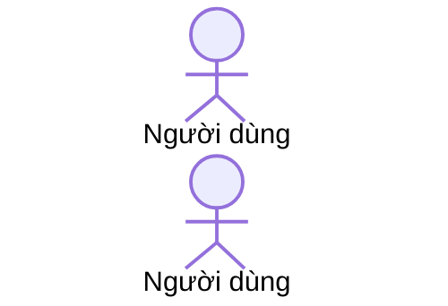

# Walkthrough · <slice>

Một trang cho người không đọc hết diff. Viết sau khi slice xong, trước verify.

## Slice làm gì
2–3 dòng, kèm mã yêu cầu (PRC-R01…).

## Đường đi của dữ liệu

## File quan trọng
| File | Vai trò | Đọc nếu muốn hiểu |
|---|---|---|

## Quyết định trong lúc làm
- (chọn cách nào, vì sao; nếu khó đảo ngược thì có ADR)

## Làm tắt / nợ
- (mã DEBT-xx trong `product/debt.md`, hoặc "không")

## Thử tay thế nào
1.
