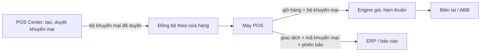

# Kiến trúc (nhẹ) · Epic Khuyến mại

## Bối cảnh

## Module
| Module | Trách nhiệm | Năng lực / mã | Thật hay giả lập |
|---|---|---|---|
| `src/pricing/eligibility.mjs` | đủ điều kiện, phạm vi món | PRM-R02..R05, R08 | thật |
| `src/pricing/engine.mjs` | áp dụng, cộng dồn, best deal, ngưỡng giỏ, phân bổ, VAT | PRM-R01, R06, R07, R10, R11; STK-R01..R15 | thật |
| `src/pricing/money.mjs` | làm tròn, chia tiền, định dạng | STK-R07, R08 | thật |
| `src/pricing/receipt.mjs` | biên lai 42 cột | STK-R13 | thật (chưa thử máy in thật) |
| `src/promotions/lifecycle.mjs` | trạng thái, duyệt 4 mắt, phiên bản, kiểm tra trường | PRM-R08, R09, R12 | slice S2 |
| Đồng bộ, POS Center, ERP | | | giả lập (ngoài epic) |

## Quy tắc xuyên suốt
- Tiền satang nguyên; giờ Bangkok dạng chuỗi; engine không I/O, cùng một code cho server và máy offline (handover §3, §5).
- Giao dịch ghi `promoSetId` và `version` của từng khuyến mại đã áp.

## Stack
| Phần | Chọn | Lý do |
|---|---|---|
| Engine | Node ≥ 22, ES modules, không thư viện | chạy được ở mọi nơi (server, POS, trình duyệt); demo chạy ngay |
| Test | `node:test` | không cài gì |

## ADR
- ADR-01 · Engine giá là hàm thuần dùng chung server và máy POS (bỏ: tính ở server rồi gửi xuống, vì offline; bỏ: hai bản code, vì lệch kết quả).
- ADR-02 · Best deal dùng thuật toán tham lam theo nhóm món tranh nhau (D-08 phương án A); bỏ: tối ưu toàn giỏ, vì bùng nổ tổ hợp với giỏ lớn.
