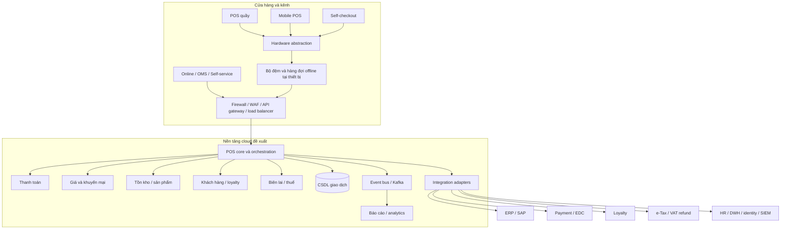
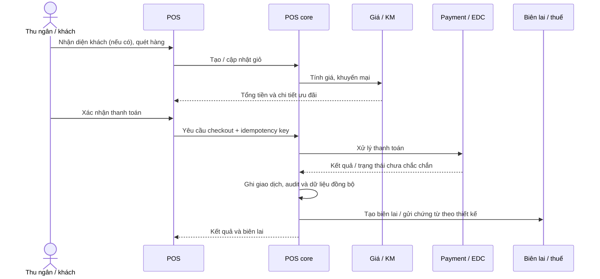
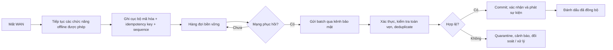
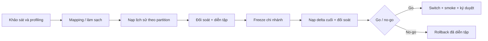
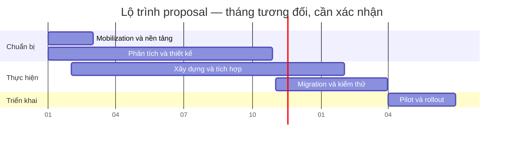

# POS — Tài liệu tổng hợp cho POC, thiết kế và triển khai

**Nguồn:** `proposal.pptx`, bản proposal ngày 25/06/2026, v1.0; tham chiếu slide bên dưới. **Tổng hợp:** 03/11/2026. Tên khách hàng và nhà thầu được thay bằng **Khách hàng** và **Nhà thầu**; không đưa tên cá nhân, địa điểm cụ thể hoặc logo vào tài liệu.

> **Trạng thái:** tài liệu làm việc, không phải đặc tả đã phê duyệt. `[P]` là nội dung/mục tiêu từ proposal; `[ĐX]` là đề xuất bổ sung để có thể lập kế hoạch; `[MỞ]` cần xác nhận. Các chỉ tiêu proposal là mục tiêu thiết kế, chưa phải kết quả đo, cam kết đã nghiệm thu hoặc chứng nhận tuân thủ. Nội dung nhúng trong một số hình không trích xuất được thành chữ; cần đối chiếu bản trình chiếu/TOR và proposal chi tiết trước khi chốt phạm vi.

## 1. Mục tiêu và bối cảnh

- `[P]` Thay POS đóng gói đã dùng trên 15 năm, hạn chế mở rộng, bảo trì và tích hợp; thiết bị cũ hạn chế hỗ trợ mobile POS và tự thanh toán (SCO). Hệ thống hiện đặt on-premise, tích hợp API, batch và file; e-tax/VAT refund còn dùng công cụ riêng. [5, 8]
- `[P]` Một nền tảng POS cloud-native, dùng chung logic cho POS quầy, mobile, SCO và các kênh khác; cải thiện tốc độ giao dịch, năng suất thu ngân, nhận diện khách và tỷ lệ chuyển đổi; hỗ trợ quyền sở hữu mã nguồn, kiểm soát OPEX và khả năng ứng dụng AI. [5, 10–14]
- `[P]` Quy mô kế hoạch: 14 chi nhánh, 505 thiết bị, khoảng 20 module, khoảng 30 tích hợp và 276 triệu bản ghi / 10 miền dữ liệu. Đây là các số ước tính cần xác nhận. [27, 31]
- `[MỞ]` TOR, bản kê yêu cầu, hợp đồng/SLA chính thức, kiến trúc mạng chi tiết, hợp đồng interface và tài liệu proposal chi tiết chưa có trong nguồn đang dùng.

## 2. Phạm vi chức năng

| Nhóm | Nội dung proposal | Cần làm rõ trước thiết kế chi tiết |
|---|---|---|
| Kênh bán | POS quầy, mobile POS, SCO; online/OMS và cổng self-service xuất hiện trong kiến trúc module. [13, 22, 31] | Phạm vi từng kênh trong từng đợt; phân quyền; hành trình SCO và xử lý cần giám sát. |
| Giao dịch | Quét sản phẩm, giỏ hàng, giá/khuyến mại, thanh toán, biên lai, trả hàng và chứng từ liên quan. [21, 22, 29] | Các trạng thái, huỷ/hoàn, chia thanh toán, làm tròn, chính sách hoàn và ngoại lệ. |
| Giá & khuyến mại | Rule engine: coupon, bundle, quy tắc theo thời gian, best-deal và override. [24] | Thứ tự ưu tiên, cộng dồn, phiên bản giá, quyền override và offline. |
| Khách hàng | Nhận diện, loyalty, hồ sơ/lịch sử, employee discount, premium redemption. [22, 24, 29] | Mã định danh, đồng ý xử lý dữ liệu, đối soát điểm và hoạt động offline. |
| Sản phẩm & tồn kho | PIM/product master, tồn gần thời gian thực, phân loại sản phẩm. [22, 24] | Nguồn chuẩn, đơn vị tính, giữ/trừ tồn, cạnh tranh giao dịch và âm tồn. |
| Quản trị | POS Center, master data, phân quyền RBAC/SSO/MFA, báo cáo, audit và bảo mật. [16, 22–24] | Ma trận vai trò, vận hành tại cửa hàng, chính sách lưu giữ và xuất dữ liệu. |
| Tích hợp | ERP/SAP, loyalty, thanh toán/EDC, thuế, HR, data warehouse, Entra ID và SIEM. [19, 31] | Danh mục đầy đủ, ownership, giao thức, payload, tần suất, SLA và sandbox. |
| AI/analytics | Phase 1: 40+ báo cáo; phase 2 có thể mở rộng data platform và AI. [16–17] | Danh sách báo cáo và định nghĩa KPI; AI use case, quyền dữ liệu và tiêu chí triển khai. |

`[P]` Bản demo chỉ trình diễn luồng đại diện và khái niệm offline/kết nối thiết bị; không bao phủ đầy đủ tổ hợp khuyến mại, ngoại lệ hoặc thuế, và không thay thế POC. [29]

## 3. Kiến trúc đích

`[P]` Proposal mô tả microservices trên AWS, PostgreSQL (slide ghi “Progress SQL”, cần xác nhận), Redis, Kafka, S3, Kubernetes; giao tiếp REST/gRPC, mTLS giữa dịch vụ và kiến trúc event-driven. Mô hình trên là tổng hợp logic, không khẳng định topology triển khai thực tế. [10, 18–19, 23]

`[MỞ]` Chưa có ranh giới service, hợp đồng API/event, cơ chế commit giao dịch liên service, vùng dữ liệu, RTO/RPO, thiết kế DR và sơ đồ mạng có thể đọc đầy đủ. Không giả định một database transaction bao phủ payment provider hay nhiều microservice.

## 4. Luồng nghiệp vụ và trạng thái

### 4.1 Bán hàng online

`[P]` Proposal nêu chuỗi scan/basket → customer/stock → promotion → payment → ACID commit → receipt/e-tax. [21] Sơ đồ trên là cách diễn đạt logic; thứ tự authorize/capture, phát hành biên lai, retry và xử lý sự cố phải được xác nhận với nhà cung cấp thanh toán/thuế. `[ĐX]` Bắt buộc thiết kế trạng thái `payment unknown` và tra cứu/đối soát trước khi thử lại để tránh thu tiền hai lần; không giả định call ngoài có thể rollback bằng ACID.

### 4.2 Offline và đồng bộ

`[P]` Đề xuất SQLite mã hóa, hàng đợi tồn tại qua restart, sequence, signature/checksum, batch 100 giao dịch, dedup và quarantine; mục tiêu buffer 8 giờ / 3.000 giao dịch, phát hiện kết nối lại <5 giây, đồng bộ khoảng 500 bản ghi/giây. [15] `[MỞ]` Xác định giao dịch/loại thanh toán được phép offline, key management, giới hạn lưu trữ, thứ tự, retry/backoff, xung đột, replay và quy trình xử lý dữ liệu bị cách ly. “Exactly once” là mục tiêu nghiệp vụ cần chứng minh bằng idempotency và reconciliation, không phải bảo đảm truyền tải mạng tự nhiên.

## 5. Dữ liệu và tích hợp

### 5.1 Các thực thể cần đặc tả

`[ĐX]` Tối thiểu: Store, Terminal, Staff/Role, Product/SKU, Price, Promotion/Rule, Customer/Loyalty reference, Basket/Line, Sale/Line, Payment/Attempt, Receipt/Tax document, Inventory movement, Sync queue, Audit event, Integration message và Reconciliation exception. Mỗi thực thể cần owner, định danh, vòng đời, quan hệ, schema/version, lưu giữ, phân loại PII và quyền truy cập. Tên này là mô hình khởi đầu, không phải schema được proposal phê duyệt.

`[ĐX]` Snapshot giá, thuế và khuyến mại tại thời điểm bán; dùng số nguyên đơn vị tiền nhỏ nhất hoặc decimal chính xác, quy định tiền tệ/làm tròn rõ ràng. Không lưu PAN thô; thiết kế tokenization và phạm vi dữ liệu thẻ theo đánh giá PCI thực tế. [23, 25]

### 5.2 Ma trận tích hợp khởi đầu

| Đối tác / miền | Luồng đề xuất để khảo sát | Tình trạng |
|---|---|---|
| ERP / SAP / SAP CAR | Master data vào; giao dịch, tài chính, tồn hoặc kết quả đối soát ra | `[P]` 7 inbound / 9 outbound với SAP; chưa có danh sách interface. [31] |
| Payment / ngân hàng / EDC / ví | Khởi tạo, kết quả, tra cứu trạng thái, huỷ/hoàn và đối soát | `[MỞ]` 26 tender được nêu nhưng chưa có catalog và hợp đồng. [22, 31] |
| Loyalty / membership | Nhận diện, tra cứu quyền lợi, tích/đổi điểm | `[MỞ]` SLA, dữ liệu và hành vi offline. [31] |
| Thuế / VAT refund | Xuất chứng từ, gửi cơ quan thuế, xử lý lỗi và trạng thái | `[MỞ]` định dạng, thời hạn, cơ chế dự phòng. [8, 31] |
| HR / identity | Nhân sự, employee discount, SSO / phân quyền | `[MỞ]` owner và mapping vai trò. [22, 31] |
| DWH / analytics / SIEM | Event hoặc batch cho báo cáo, giám sát và an ninh | `[MỞ]` schema, độ trễ và masking. [19, 31] |

`[ĐX]` Mỗi interface cần đặc tả producer/consumer, sync/async, auth, định dạng, idempotency, timeout, retry, thứ tự, reconciliation, DLQ/quarantine, SLA, test sandbox và chủ sở hữu.

### 5.3 Migration và cutover

`[P]` Khoảng 276 triệu bản ghi / 10 dataset, trong đó e-journal khoảng 250 triệu; lịch sử nạp một lần, delta theo từng chi nhánh. Thực hiện profiling, mapping, ETL có audit, xác minh, đối soát count/amount/integrity, dry run và diễn tập rollback. Source access mục tiêu trước M4; cần sizing và kiểm chứng throughput. [25, 31, 36]

`[MỞ]` Proposal nêu lưu giữ 10 năm như giả định; legal/compliance phải xác nhận nghĩa vụ, phạm vi và xóa dữ liệu. Chốt định nghĩa freeze, ngưỡng sai lệch, dữ liệu sau switch và điểm không thể rollback trước mỗi đợt.

## 6. Chỉ tiêu phi chức năng và các điểm mâu thuẫn

| Nhóm | Mục tiêu trong proposal | Việc cần xác nhận / đo |
|---|---|---|
| Availability | 99,9% uptime. [10] | Phạm vi, cửa sổ đo, maintenance exclusions, SLA từng dependency và phương pháp đo. |
| Tải | 1.000–5.000 TPS; 1.000+ endpoints. [10, 23] | Đơn vị TPS, mix, peak duration, đồng thời, số cửa hàng và môi trường tương đương production. |
| Độ trễ | P50 <300 ms, P99 <1 giây; slide khác ghi P50 khoảng 250 ms. [21, 23] | **Mâu thuẫn:** riêng payment được ước tính ~1.100 ms, lớn hơn P99 tổng <1 giây. Tách API nội bộ khỏi toàn hành trình gồm mạng/EDC/provider; định nghĩa điểm bắt đầu/kết thúc và percentile. |
| Offline | 8 giờ/3.000 giao dịch, batch 100, reconnect <5 giây, khoảng 500 record/s. [15] | Mỗi terminal hay cửa hàng, điều kiện dữ liệu, sức chứa và kịch bản mất điện/mạng. |
| Bảo mật | TLS 1.3, mTLS, tokenization, HSM, JWT 15 phút, RBAC/MFA, PCI-DSS Level 1 được đề cập. [23] | Phạm vi CDE, trách nhiệm đối tác, threat model, key rotation, xác thực ngoại lệ và đánh giá độc lập; thiết kế không tự tạo chứng nhận PCI. |
| Scale | Kubernetes autoscale 2–10 pods tại 75%. [23] | Đơn vị metric, sizing theo tải, giới hạn DB/Kafka, HA đa AZ và cấu hình thực tế. |
| Analytics | 40+ báo cáo phase 1; phase 2 tùy chọn, độ trễ 15–30 giây. [16] | Nguồn, chất lượng, refresh, KPI, phân quyền và acceptance cho từng báo cáo. |
| AI | 6–12 tháng dữ liệu training, API <500 ms, fallback theo rule. [17] | Quyền sử dụng dữ liệu, tập mẫu, model ownership, drift, chi phí và trường hợp dùng. |

`[MỞ]` Số liệu cải thiện chi phí hạ tầng, “zero loss” và zero revenue loss là mục tiêu/nhận định của proposal; không coi là kết quả đã được chứng minh. Xác nhận chính sách xung đột: proposal nêu last-write-wins nhưng có thể không phù hợp dữ liệu tiền/tồn; cần quyết định theo từng loại dữ liệu. [10, 23]

## 7. Thiết bị và kỹ thuật kênh

| Kênh | Đề xuất [13, 27] | Số lượng | Điểm kiểm chứng |
|---|---|---:|---|
| POS quầy | Toshiba TCx820, ứng dụng .NET, máy in, ngăn kéo, EMV/NFC, UPS | 444 | Driver/SDK, ngoại vi, in ấn, offline, bảo trì. |
| SCO | Toshiba TCx820, Kotlin, scanner, printer, hỗ trợ giám sát từ xa | 15 | OS/runtime Kotlin, can thiệp supervisor, an toàn luồng thanh toán. |
| Mobile | Zebra ET401, Kotlin, NFC, MDM; đề xuất 10 giờ ca / ~300 giao dịch | 46 | Tính tương thích SDK/EDC, pin và hiệu năng trong cửa hàng. |

`[P]` Các con số là đề xuất thiết bị, không thay thế kết quả nghiệm thu hoặc khảo sát thực tế. `[MỞ]` Kiểm tra model, OS, vòng đời hỗ trợ, firmware, chứng nhận và tính tương thích thực tế với từng thiết bị ngoại vi.

## 8. Kế hoạch POC đề xuất

`[ĐX]` Mục đích là kiểm chứng rủi ro kiến trúc và nghiệp vụ trước khi cam kết bản thiết kế, không xem POC là production-ready.

| Bước | Phạm vi / kết quả | Tiêu chí minh chứng đề xuất |
|---|---|---|
| 1. Baseline | Xác nhận 1 cửa hàng thử, 1 SKU set, 1 bộ rule, hợp đồng sandbox, thiết bị và workload. | Scope, dataset, chỉ tiêu và owner được hai bên duyệt. |
| 2. Giao dịch | Scan → nhận diện giả lập → giá/KM → thanh toán sandbox → biên lai. | Tổng tiền đúng theo bộ ví dụ được duyệt; audit truy vết; test lỗi cơ bản. |
| 3. Offline | Mất mạng, tiếp tục phạm vi được phép, restart, khôi phục, gửi trùng và quarantine. | Không mất bản ghi hợp lệ và không ghi trùng sau retry trong bộ test; có báo cáo đối soát. |
| 4. Tích hợp | Mock/adapter cho ERP, loyalty, payment, e-tax; ít nhất một sandbox thực nếu có quyền. | Contract tests, timeout, retry và reconciliation được chứng minh; mock ghi rõ. |
| 5. Thiết bị | Một terminal / scanner / printer / EDC đại diện; mobile hoặc SCO nếu có. | Kết quả từng thiết bị, model/firmware, kịch bản lỗi và thời gian khôi phục. |
| 6. NFR và bảo mật | Load theo profile đã chốt; đo latency nội bộ và payment end-to-end tách biệt; kiểm tra bảo mật cơ bản. | Báo cáo cấu hình, p50/p95/p99, throughput, lỗi, bottleneck và giới hạn. |
| 7. Quyết định | Demo, báo cáo sai lệch, chi phí, rủi ro, ADR và backlog giai đoạn tiếp. | Người có thẩm quyền quyết định pass/fail và những ngoại lệ còn mở. |

`[MỞ]` Khối lượng POC, môi trường, dữ liệu, công cụ, ngưỡng đo và ngày hoàn thành chưa được proposal chốt; bảng trên là đề xuất, không phải cam kết.

## 9. Lộ trình triển khai và vận hành

`[P]` Chương trình tham chiếu 18 tháng: pilot mục tiêu Q3/2027, go-live Q4/2027; cần kiểm tra lại mốc khởi động và tính khả thi. [5, 34] Các pha dưới là tóm tắt tương đối, không suy diễn độ dài từ biểu đồ có phần nội dung nhúng trong hình.

Biểu đồ chỉ minh họa M1–M18 bằng ngày giả lập (M1 = 01/2026), **không phải lịch thực**. Proposal nêu analysis/design M1–M10, build/integration M2–M13, migration/verification M11–M15, rollout M16–M18. [39] Build, mua sắm thiết bị và chuẩn bị migration chạy song song; pilot trước, sau đó 5 đội triển khai 13 chi nhánh, khoảng 2 tuần mỗi nhóm và hypercare theo chi nhánh. [32, 35, 37]

`[P]` Quy trình một chi nhánh: T−2 tuần kiểm tra readiness; T−1–2 tuần đào tạo; T−1 tuần cài/harden thiết bị và cấu hình; T−2–3 ngày mô phỏng; đêm cutover freeze, delta và đối soát; switch/smoke, sign-off; theo dõi ngày 1/3/7; rollback nếu không đạt go/no-go. [38]

`[P]` Quản trị: steering hàng tháng, working committee hàng tuần; CR → phân tích → đánh giá tác động → CCB → triển khai/regression → release và thông báo. Khách hàng chủ trì nghiệp vụ/UAT, IT/security chịu trách nhiệm phê duyệt thiết kế/tích hợp, nhà thầu xây dựng và hỗ trợ; ma trận chi tiết cần đối chiếu slide 41. [41, 49, 52]

## 10. Kiểm thử và vận hành sau go-live

`[ĐX]` Ma trận nghiệm thu tối thiểu: unit và contract; integration với sandbox; SIT end-to-end; UAT theo vai trò/chi nhánh; tổ hợp promotion/tax; payment timeout, duplicate và refund; offline/restart/replay/quarantine; migration reconciliation/rollback; security/pentest; load/soak/failover; kiểm thử thiết bị, in, MDM và đào tạo. Mỗi case cần requirement ID, dữ liệu, expected result, owner, bằng chứng và defect severity.

`[P]` Hypercare: command center, health check, điều phối sự cố, runbook/KEDB và chuyển giao. Mục tiêu đề xuất [55, 57]:

| Mức | Phản hồi đầu | Khôi phục / workaround | Giải quyết | Cập nhật |
|---|---:|---:|---:|---:|
| Sev-1 | 15 phút | ≤2 giờ | 4–8 giờ | 30 phút |
| Sev-2 | 30 phút | ≤4 giờ | ≤1 ngày làm việc | 1 giờ |
| Sev-3 | 4 giờ | Không nêu | ≤3 ngày làm việc | Hàng ngày |
| Sev-4 | 1 ngày làm việc | Không nêu | Theo thỏa thuận | Theo thỏa thuận |

`[P]` MA sau hypercare dự kiến năm 1–5/6–10; bao gồm incident/problem, request, change/release, tài liệu và hỗ trợ môi trường. Nâng cấp lớn và lỗi nền tảng bên thứ ba không mặc định thuộc base MA; nhà thầu phối hợp theo RACI. SLA MA có mục tiêu khác hypercare, cần xác nhận coverage window và ngoại lệ trong hợp đồng. [59–64] Ví dụ MA Sev-1: phản hồi 15 phút, workaround ≤2 giờ, giải quyết 8–16 giờ, cập nhật 60 phút. [61]

## 11. Quyết định cần chốt trước khi viết spec chi tiết

1. `[MỞ]` TOR và phạm vi bắt buộc/ngoài phạm vi theo module, kênh, chi nhánh; danh sách 20 module và 30 tích hợp thực tế.
2. `[MỞ]` NFR đã điều chỉnh: end-to-end vs nội bộ, tải, availability, DR, bảo mật, giới hạn offline và SLA đối tác.
3. `[MỞ]` Hợp đồng thanh toán: authorize/capture, idempotency, trạng thái không chắc chắn, hoàn/hủy, đối soát và phương thức chấp nhận khi offline.
4. `[MỞ]` Quy tắc giá, promotion, thuế, loyalty, inventory, hoàn hàng và quyền override theo từng kênh.
5. `[MỞ]` Dữ liệu và migration: schema nguồn, chất lượng, lưu giữ, quyền truy cập, delta, đối soát, rollback và test data.
6. `[MỞ]` Kiến trúc triển khai, ranh giới service, ownership dữ liệu, thiết kế network, event delivery, secrets, logging và giám sát.
7. `[MỞ]` Thiết bị/SDK, môi trường sandbox, kết nối chi nhánh, lead time, điều kiện nghiệm thu thực địa.
8. `[MỞ]` Lịch thực, ngân sách, resource plan, phân công RACI, dependency của bên thứ ba, cơ chế sign-off và hypercare/MA.

## 12. Bộ đầu ra cần tạo tiếp

`[ĐX]` Sau khi xác nhận các điểm trên, tạo và quản lý version: (1) BRS/RTM và backlog; (2) HLD, threat model và ADR; (3) spec API/event và integration catalog; (4) mô hình dữ liệu, mapping và migration/cutover runbook; (5) UX/flow theo vai trò; (6) POC charter và báo cáo; (7) test plan, workload và acceptance matrix; (8) rollout/rollback, vận hành, SLA/RACI và kế hoạch chuyển giao. Không coi tài liệu tổng hợp này thay thế các đầu ra đó.
