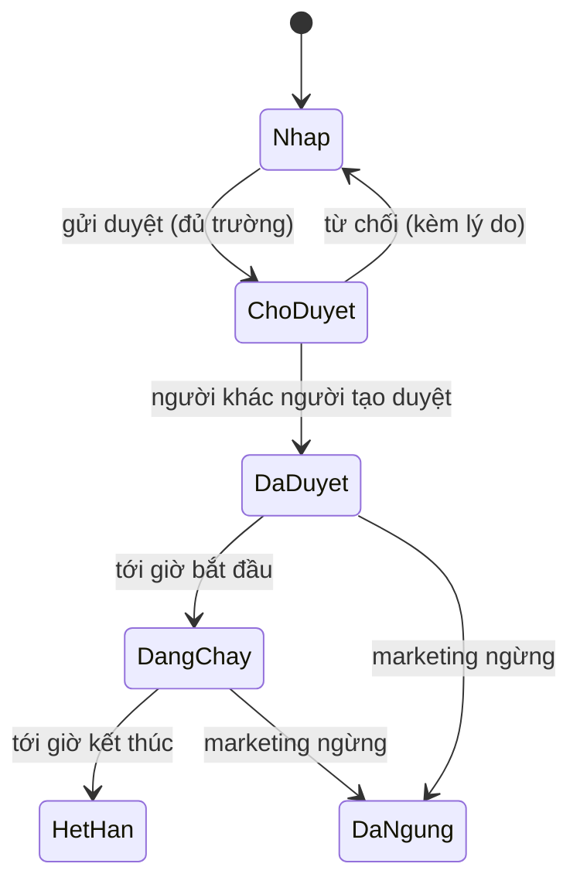

# Định nghĩa và điều kiện khuyến mại (PRM)

## Tóm tắt
Một khuyến mại gồm: loại và mức giảm, khung giờ, cửa hàng, nhóm khách, phạm vi món, ngưỡng, giới hạn, trạng thái và phiên bản. Năng lực này trả lời "khuyến mại này có đủ điều kiện cho giỏ hàng này không". Chọn và cộng dồn giữa nhiều khuyến mại là STK. Coupon, override, loyalty nằm ngoài (xem bản đồ).
Nguồn: `product/source/pos-system-handover.md` §2; `knowledge/domain/promotions.md`.

## Vai trò
| Vai trò | Được làm | Không được làm |
|---|---|---|
| Marketing | tạo, sửa bản nháp, gửi duyệt, ngừng khuyến mại | duyệt khuyến mại mình tạo |
| Người duyệt | duyệt, từ chối kèm lý do | duyệt khuyến mại mình tạo |
| Quản lý cửa hàng | xem khuyến mại đang chạy ở cửa hàng mình | tạo, sửa, duyệt |
| Thu ngân | thấy khuyến mại được áp trên giỏ | sửa, tắt khuyến mại |

## Luật
| Mã | Khi | Thì | Ghi chú / nguồn |
|---|---|---|---|
| PRM-R01 | Tạo khuyến mại | Chọn 1 trong 6 loại: giảm % theo món; giảm số tiền theo món; giá đặc biệt; mua X tặng Y (tặng món rẻ nhất trong phạm vi); combo giá cố định; giảm theo ngưỡng giỏ hàng (% hoặc số tiền) | handover §2 (bundle, best-deal); `knowledge/domain/promotions.md` |
| PRM-R02 | Xét khuyến mại cho một giao dịch | Chỉ đủ điều kiện nếu thời điểm xét (STK-R12) nằm trong [bắt đầu, kết thúc), giờ Asia/Bangkok | kết thúc không bao gồm |
| PRM-R03 | Khuyến mại có danh sách cửa hàng | Máy của cửa hàng không có trong danh sách thì không đủ điều kiện; danh sách rỗng = mọi cửa hàng | |
| PRM-R04 | Khuyến mại giới hạn nhóm khách (thành viên, nhân viên) | Chỉ đủ điều kiện khi khách đã được nhận diện thuộc nhóm đó trước lúc xét | nhận diện sau khi bấm tổng: STK-R10 |
| PRM-R05 | Xác định món thuộc phạm vi | Món thuộc phạm vi nếu khớp danh sách mã hàng, ngành hàng hoặc thương hiệu, và không nằm trong danh sách loại trừ; loại trừ thắng | |
| PRM-R06 | Khuyến mại có ngưỡng số lượng hoặc số tiền | Đủ điều kiện khi số lượng ≥ ngưỡng, hoặc số tiền ≥ ngưỡng (tiền tính theo STK-R06) | "≥" bao gồm ngưỡng |
| PRM-R07 | Mua X tặng Y, số lượng trong giỏ là n | Áp dụng floor(n / (X + Y)) lần, không quá giới hạn số lần mỗi giao dịch nếu có | |
| PRM-R08 | Đổi trạng thái | Nháp → Chờ duyệt → Đã duyệt → (Đang chạy / Hết hạn / Đã ngừng); chỉ khuyến mại Đã duyệt được gửi xuống máy; người duyệt khác người tạo | D-05 |
| PRM-R09 | Sửa khuyến mại Đã duyệt | Tạo phiên bản mới ở trạng thái Chờ duyệt; phiên bản cũ chạy tiếp đến khi bản mới được duyệt; giao dịch ghi mã và phiên bản đã áp | handover §5 (snapshot) |
| PRM-R10 | Mức giảm lớn hơn giá dòng | Giảm tối đa bằng giá dòng; giá sau giảm không âm | |
| PRM-R11 | Khuyến mại có mức giảm tối đa | Số tiền giảm của khuyến mại trong một giao dịch không vượt mức này | |
| PRM-R12 | Thiếu trường bắt buộc khi gửi duyệt | Không cho gửi duyệt; báo từng trường thiếu | bắt buộc: tên, loại, mức giảm, bắt đầu, kết thúc, phạm vi món |

## Kịch bản
- **PRM-S01** [auto] Given khuyến mại "Sữa −10%" Đã duyệt từ 01/12 00:00 đến 01/01 00:00 cho mọi cửa hàng When thu ngân bấm tổng lúc 15/12 10:00 với 2 hộp sữa Then khuyến mại đủ điều kiện cho 2 dòng sữa.
- **PRM-S02** [auto] Given khuyến mại chỉ cho thành viên When khách chưa được nhận diện lúc bấm tổng Then khuyến mại không đủ điều kiện.
- **PRM-S03** [auto] Given ngành hàng Đồ uống trong phạm vi và Cola trong danh sách loại trừ When giỏ có Cola và Sữa Then chỉ Sữa thuộc phạm vi.
- **PRM-S04** [semi] Given marketing A tạo khuyến mại When A mở màn hình duyệt Then nút Duyệt bị khoá và hiện lý do.
- **PRM-S05** [auto] Given phiên bản 1 đang chạy và phiên bản 2 Chờ duyệt When bán hàng Then áp phiên bản 1 và giao dịch ghi "phiên bản 1".
- **PRM-S06** [manual] Given khuyến mại vừa được duyệt When máy của 3 cửa hàng trong danh sách đồng bộ Then khuyến mại xuất hiện ở 3 máy đó và không xuất hiện ở cửa hàng khác.

## Trạng thái

## Màn hình và trường
| Màn hình | Trường / hành động | Bắt buộc | Kiểm tra hợp lệ | Ai thấy |
|---|---|---|---|---|
| Tạo khuyến mại (POS Center) | Tên (TH + EN) | có | 1–60 ký tự | Marketing |
| | Loại (6 loại, PRM-R01) | có | | |
| | Mức giảm: % / số tiền / giá đặc biệt / X, Y / giá combo | có | % trong (0, 100]; tiền > 0 | |
| | Bắt đầu, kết thúc | có | kết thúc > bắt đầu | |
| | Cửa hàng | không | rỗng = mọi cửa hàng | |
| | Nhóm khách | không | tất cả / thành viên / nhân viên | |
| | Phạm vi món: mã hàng, ngành hàng, thương hiệu; loại trừ | có | ít nhất 1 món hoặc 1 nhóm | |
| | Ngưỡng số lượng / số tiền | không | > 0 | |
| | Số lần tối đa mỗi giao dịch, mức giảm tối đa | không | > 0 | |
| | Cộng dồn (có / không), độ ưu tiên (1 = cao nhất) | có | ưu tiên 1–99 | |
| Duyệt khuyến mại | Duyệt, từ chối (lý do bắt buộc) | | người duyệt ≠ người tạo | Người duyệt |
| Danh sách khuyến mại | lọc theo trạng thái, cửa hàng, ngày | | | Marketing, quản lý cửa hàng |

## Điểm chạm
| Với | Chiều | Dữ liệu | Khi lỗi |
|---|---|---|---|
| Danh mục sản phẩm (ERP / PIM) | vào | mã hàng, ngành hàng, thương hiệu | món không còn trong danh mục: cảnh báo trên khuyến mại, không áp cho món đó |
| Máy POS | ra | bộ khuyến mại Đã duyệt theo cửa hàng, có mã bộ | máy giữ bộ cũ (STK-R14) |

## Biến thể
Cửa hàng (PRM-R03) · nhóm khách (PRM-R04) · khung giờ (PRM-R02).

## Giả định
- Khung giờ dùng giờ Asia/Bangkok cho mọi cửa hàng (14 chi nhánh cùng múi giờ).
- Tên khuyến mại có tiếng Thái và tiếng Anh để in biên lai.
- Người duyệt khác người tạo (D-05).

## Câu hỏi mở
- D-05 · Có cần duyệt 4 mắt · đề xuất có · đang dùng: có.
- D-03 · Thời điểm xét khuyến mại · đề xuất lúc bấm tổng · đang dùng: lúc bấm tổng.

## Ngoài phạm vi
- Coupon, override của thu ngân, tích / đổi điểm, khuyến mại theo phương thức thanh toán, khuyến mại kênh online.
